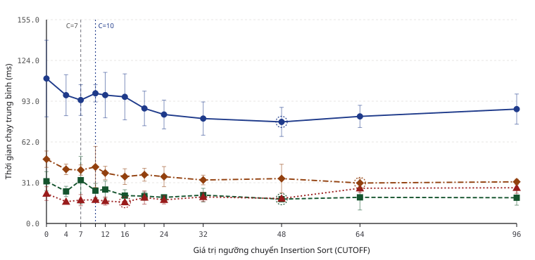
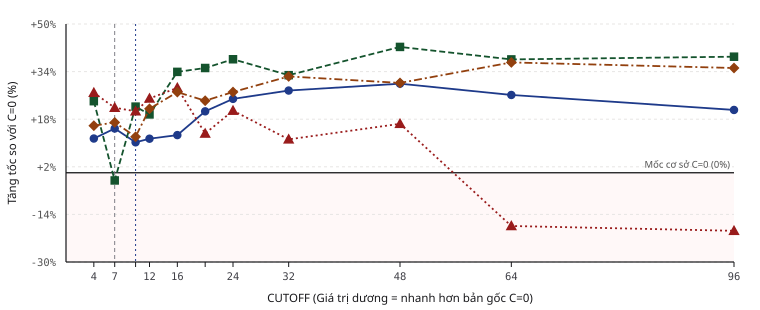
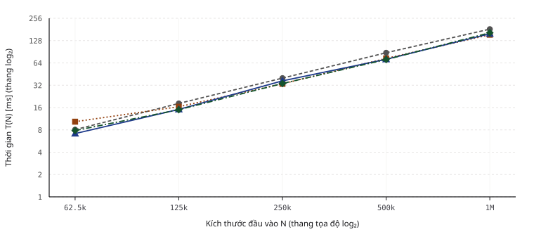

# Phân tích thực nghiệm tìm giá trị CUTOFF tối ưu cho thuật toán MergeSort

- **Học phần:** Cấu trúc dữ liệu và Giải thuật 
- **Sinh viên thực hiện:** Bùi Hà Linh — **MSSV:** 25020233 
- **Ngày lập báo cáo:** 19/11/2026

---

## Tóm tắt

Thí nghiệm đánh giá ảnh hưởng của ngưỡng `CUTOFF` khi MergeSort chuyển sang Insertion Sort trên các mảng con nhỏ. Bộ `results.csv` mới có **436 phép đo**, trong đó Thí nghiệm A gồm **336 phép đo** (4 phân phối × 7 trials × 12 cutoff) và Thí nghiệm B gồm **100 phép đo** (5 kích thước × 5 trials × 4 cutoff). Tất cả 436 lần chạy đều vượt qua hậu kiểm `isSorted()`.

Tại `N = 500,000`, cutoff cho thời gian trung bình thấp nhất theo từng phân phối lần lượt là **48** (Random: 77.249 ms), **48** (Nearly Sorted: 18.518 ms), **16** (Reverse: 16.236 ms) và **64** (Few Unique: 30.760 ms). Không có một cutoff duy nhất cho kết quả tốt nhất trên mọi phân phối. Nếu tối đa hóa mức tăng tốc trung bình cộng trên bốn phân phối, cutoff tốt nhất trong dải khảo sát là **48** (29.72%); nếu ưu tiên tiêu chí thận trọng — tối đa hóa mức cải thiện thấp nhất trong bốn phân phối — thì **24** là lựa chọn cân bằng hơn (mức tăng tốc thấp nhất vẫn là 20.87%). Doubling Ratio Test nhìn chung phù hợp với xu hướng tăng trưởng `Θ(N log N)`, dù các tỉ số từng bước có dao động.

## 1. Đặt vấn đề & Cơ sở lý thuyết

MergeSort đảm bảo độ phức tạp **Θ(N log N)** trong mọi trường hợp, nhưng khi đệ quy thuần túy đến mảng độ dài 1 (`CUTOFF = 0`), cây đệ quy phát sinh xấp xỉ `2N - 1` lời gọi hàm. Tại các tầng lá kích thước nhỏ, chi phí tạo khung ngăn xếp (*stack frame*), tính trung điểm và sao chép mảng phụ `aux[k] = arr[k]` chiếm tỉ trọng lớn.

Ngược lại, *Insertion Sort* thao tác tại chỗ (*in-place*), tận dụng tốt tính cục bộ của bộ nhớ đệm L1 và có hằng số ẩn rất nhỏ trên mảng ngắn. Khi kết hợp hai thuật toán với ngưỡng `K = CUTOFF`, tổng thời gian thực thi có thể giảm đi đáng kể.

Tuy vậy, trong thực tế, mức CUTOFF tối ưu có thể khác nhau tùy thuộc vào thông số máy, loại dữ liệu hay phân bổ dữ liệu cụ thể. Vì vậy, thí nghiệm sau đây sẽ kiểm tra thời gian chạy của các mức CUTOFF đối với máy của sinh viên trong một số trường hợp khác nhau.

## 2. Thiết kế thí nghiệm & Cấu hình hệ thống

Cài đặt sử dụng MergeSort top-down, một mảng phụ `aux` được cấp phát một lần ở đầu mỗi lần gọi `mergeSortWithCutoff`, và Insertion Sort cho đoạn con có kích thước không vượt quá cutoff. Dữ liệu của mỗi trial được tạo, lưu thành file rồi đọc lại trước khi benchmark; các cutoff trong cùng trial nhận bản sao của cùng mảng đầu vào.

#### Bảng 1. Cấu hình phần cứng và quy trình kiểm soát sai số đo

| Hạng mục | Thông số & Cơ chế kiểm soát |
| :--- | :--- |
| **Môi trường phần cứng & JVM** | CPU: 13th Gen Intel Core i5 (10 Cores, 12 Logical Processors); RAM: 16 GB; Windows 11 (64-bit); OpenJDK 21 LTS (64-Bit Server VM) |
| **Làm nóng JVM (Warm-up)** | 12 lượt sắp xếp mảng ngẫu nhiên `N = 50,000`, xen kẽ `C=0` và `C=10`; gọi `System.gc()` trước khi đo |
| **Thí nghiệm A (Quét CUTOFF)** | `N = 500,000`, 7 trials, seed `1000..1006`, quét `CUTOFF ∈ {0, 4, 7, 10, 12, 16, 20, 24, 32, 48, 64, 96}` |
| **4 phân phối kiểm thử** | `random`; `nearly_sorted` (hoán vị ngẫu nhiên 2.5% số lần so với mảng tăng dần); `reverse` (giảm dần); `few_unique` (16 giá trị có thể có) |
| **Thí nghiệm B (Doubling Ratio)** | Phân phối `random`, `N ∈ {62,500, 125,000, 250,000, 500,000, 1,000,000}`, 5 trials, seed `2000..2004`, cutoff `{0, 7, 10, 24}` |
| **Đồng hồ & hậu kiểm** | `System.nanoTime()` đổi sang ms; kiểm tra `isSorted()` sau mỗi lần sắp xếp |
| **Phân tách hai thí nghiệm** | Dựa vào seed: A `1000..1006`; B `2000..2004`, đặc biệt cần thiết tại `N=500,000` |

**Cách tính:** `Mean` là trung bình 7 lần chạy; `StdDev` là độ lệch chuẩn mẫu; `95% CI` trong các bảng A được tính theo khoảng tin cậy t hai phía với 6 bậc tự do: `t(0.975, 6) × s / √7` (hệ số xấp xỉ 2.447). Mức tăng tốc được tính bằng `(Mean(C=0) − Mean(C)) / Mean(C=0) × 100%`; số dương nghĩa là nhanh hơn bản gốc.

## 3. Kết quả quét dải CUTOFF (Thí nghiệm A)

#### Bảng 2. Tổng hợp so sánh C=0, C=7, C=10 và cutoff có mean thấp nhất tại N = 500,000

| Phân phối | C = 0 (ms) | C = 7 (ms / %) | C = 10 (ms / %) | C tối ưu theo mean | Mean tối ưu (ms) | Tăng tốc tối đa |
| :--- | ---: | ---: | ---: | ---: | ---: | ---: |
| Random | 110.255 | 93.856 (+14.87%) | 98.976 (+10.23%) | **48** | **77.249** | **+29.94%** |
| Nearly Sorted | 32.092 | 32.924 (-2.59%) | 24.959 (+22.23%) | **48** | **18.518** | **+42.30%** |
| Reverse | 22.721 | 17.756 (+21.85%) | 18.025 (+20.67%) | **16** | **16.236** | **+28.54%** |
| Few Unique | 48.889 | 40.619 (+16.92%) | 42.972 (+12.10%) | **64** | **30.760** | **+37.08%** |

### 3.1. Bảng số liệu thống kê chi tiết theo từng phân phối

#### Bảng 3.1. Thống kê chi tiết phân phối Random (N = 500,000, TRIALS = 7)

| CUTOFF | Mean (ms) | StdDev s (ms) | 95% CI (± ms) | Min – Max (ms) | So với C=0 (%) |
| :--- | ---: | ---: | ---: | ---: | ---: |
| 0 (Gốc) | 110.255 | 29.134 | ± 26.944 | 85.90 – 160.76 | +0.00% |
| 4 | 97.573 | 15.581 | ± 14.410 | 75.66 – 119.54 | +11.50% |
| 7 (GT cũ) | 93.856 | 11.682 | ± 10.804 | 78.27 – 110.56 | +14.87% |
| 10 (GT mới) | 98.976 | 6.572 | ± 6.078 | 91.52 – 108.89 | +10.23% |
| 12 | 97.637 | 17.266 | ± 15.968 | 77.63 – 129.17 | +11.44% |
| 16 | 96.300 | 17.477 | ± 16.163 | 73.16 – 117.55 | +12.66% |
| 20 | 87.493 | 13.156 | ± 12.168 | 72.12 – 104.37 | +20.64% |
| 24 | 82.872 | 10.935 | ± 10.113 | 70.31 – 95.87 | +24.84% |
| 32 | 79.789 | 12.656 | ± 11.705 | 67.98 – 100.77 | +27.63% |
| **48 (Tối ưu)** | 77.249 | 11.063 | ± 10.232 | 67.95 – 99.48 | +29.94% |
| 64 | 81.430 | 8.429 | ± 7.795 | 69.83 – 90.42 | +26.14% |
| 96 | 86.982 | 11.477 | ± 10.615 | 71.15 – 105.74 | +21.11% |
#### Bảng 3.2. Thống kê chi tiết phân phối Nearly Sorted (N = 500,000, TRIALS = 7)

| CUTOFF | Mean (ms) | StdDev s (ms) | 95% CI (± ms) | Min – Max (ms) | So với C=0 (%) |
| :--- | ---: | ---: | ---: | ---: | ---: |
| 0 (Gốc) | 32.092 | 7.319 | ± 6.769 | 24.83 – 43.95 | +0.00% |
| 4 | 24.373 | 3.891 | ± 3.599 | 20.50 – 30.83 | +24.05% |
| 7 (GT cũ) | 32.924 | 18.043 | ± 16.687 | 21.23 – 72.61 | -2.59% |
| 10 (GT mới) | 24.959 | 5.448 | ± 5.039 | 20.40 – 33.83 | +22.23% |
| 12 | 25.799 | 6.498 | ± 6.009 | 18.97 – 38.63 | +19.61% |
| 16 | 21.210 | 4.423 | ± 4.090 | 17.78 – 30.72 | +33.91% |
| 20 | 20.793 | 3.118 | ± 2.883 | 18.46 – 27.41 | +35.21% |
| 24 | 19.850 | 1.517 | ± 1.403 | 17.82 – 22.67 | +38.15% |
| 32 | 21.566 | 5.161 | ± 4.773 | 16.72 – 31.97 | +32.80% |
| **48 (Tối ưu)** | 18.518 | 1.712 | ± 1.583 | 16.95 – 21.40 | +42.30% |
| 64 | 19.866 | 9.589 | ± 8.869 | 15.21 – 41.43 | +38.10% |
| 96 | 19.572 | 5.676 | ± 5.249 | 15.83 – 31.73 | +39.01% |
#### Bảng 3.3. Thống kê chi tiết phân phối Reverse (N = 500,000, TRIALS = 7)

| CUTOFF | Mean (ms) | StdDev s (ms) | 95% CI (± ms) | Min – Max (ms) | So với C=0 (%) |
| :--- | ---: | ---: | ---: | ---: | ---: |
| 0 (Gốc) | 22.721 | 5.236 | ± 4.842 | 19.61 – 34.10 | +0.00% |
| 4 | 16.610 | 0.934 | ± 0.864 | 15.71 – 18.34 | +26.90% |
| 7 (GT cũ) | 17.756 | 4.234 | ± 3.915 | 15.59 – 27.28 | +21.85% |
| 10 (GT mới) | 18.025 | 1.444 | ± 1.335 | 16.19 – 20.22 | +20.67% |
| 12 | 17.050 | 3.137 | ± 2.901 | 15.22 – 24.11 | +24.96% |
| **16 (Tối ưu)** | 16.236 | 0.811 | ± 0.750 | 15.34 – 17.48 | +28.54% |
| 20 | 19.727 | 5.010 | ± 4.634 | 15.55 – 28.03 | +13.18% |
| 24 | 17.979 | 3.145 | ± 2.909 | 15.61 – 23.58 | +20.87% |
| 32 | 20.171 | 3.445 | ± 3.186 | 17.86 – 27.78 | +11.23% |
| 48 | 18.984 | 1.135 | ± 1.050 | 17.61 – 20.33 | +16.45% |
| 64 | 26.787 | 3.139 | ± 2.903 | 24.79 – 33.32 | -17.90% |
| 96 | 27.155 | 4.192 | ± 3.877 | 24.28 – 36.38 | -19.52% |
#### Bảng 3.4. Thống kê chi tiết phân phối Few Unique (N = 500,000, TRIALS = 7)

| CUTOFF | Mean (ms) | StdDev s (ms) | 95% CI (± ms) | Min – Max (ms) | So với C=0 (%) |
| :--- | ---: | ---: | ---: | ---: | ---: |
| 0 (Gốc) | 48.889 | 6.215 | ± 5.748 | 41.93 – 58.25 | +0.00% |
| 4 | 41.159 | 3.997 | ± 3.697 | 37.00 – 47.09 | +15.81% |
| 7 (GT cũ) | 40.619 | 3.897 | ± 3.604 | 36.85 – 47.47 | +16.92% |
| 10 (GT mới) | 42.972 | 15.636 | ± 14.461 | 33.95 – 77.95 | +12.10% |
| 12 | 38.378 | 5.101 | ± 4.717 | 33.98 – 46.65 | +21.50% |
| 16 | 35.637 | 5.966 | ± 5.518 | 30.37 – 47.49 | +27.11% |
| 20 | 37.050 | 4.864 | ± 4.499 | 32.06 – 42.72 | +24.22% |
| 24 | 35.622 | 7.643 | ± 7.069 | 30.24 – 49.96 | +27.14% |
| 32 | 33.059 | 3.646 | ± 3.372 | 28.30 – 39.08 | +32.38% |
| 48 | 34.127 | 10.892 | ± 10.073 | 28.09 – 58.43 | +30.20% |
| **64 (Tối ưu)** | 30.760 | 3.368 | ± 3.115 | 28.16 – 37.84 | +37.08% |
| 96 | 31.675 | 1.930 | ± 1.785 | 28.74 – 33.65 | +35.21% |

## 4. Kiểm chứng độ phức tạp — Doubling Ratio Test (Thí nghiệm B)

Nếu thời gian chạy tuân theo `T(N) ≈ a · N log₂N`, tỉ số khi tăng gấp đôi kích thước có xu hướng tiến gần `2` (chính xác hơn là `2 × log₂(2N)/log₂(N)`, giảm dần về 2 khi N tăng). Với dữ liệu thực nghiệm hữu hạn và số lần lặp ít, các tỉ số quan sát được có thể dao động do nhiễu đo.

#### Bảng 4. Doubling Ratio Test trên phân phối Random (5 lần lặp/mốc, seed 2000..2004)

| Kích thước N | C = 0 (ms) | C = 7 (ms) | C = 10 (ms) | C = 24 (ms) | T(N)/T(N/2) [C=10] | b = log₂(ratio) |
| :--- | ---: | ---: | ---: | ---: | ---: | ---: |
| 62,500 | 8.062 | 10.320 | 7.137 | 7.830 | --- | --- |
| 125,000 | 18.188 | 16.418 | 15.118 | 14.973 | 2.118 | 1.083 |
| 250,000 | 39.925 | 33.441 | 36.688 | 33.785 | 2.427 | 1.279 |
| 500,000 | 87.784 | 73.645 | 71.664 | 71.107 | 1.953 | 0.966 |
| 1,000,000 | 182.734 | 153.580 | 158.320 | 163.198 | 2.209 | 1.144 |

Các tỉ số liên tiếp tại `C=10` lần lượt là **2.118, 2.427, 1.953, 2.209**, trung bình **2.177**; trung bình `log₂(ratio)` là **1.118**. Để đối chiếu, tỉ số trung bình của `C=0` là **2.183**, còn `C=7` là **1.979**. Các giá trị không tăng đều theo từng bước, nhưng thời gian trung bình nhìn chung tăng theo N và các tỉ số quanh 2 ở phần lớn bước tăng kích thước. Vì vậy, dữ liệu phù hợp với kỳ vọng thực nghiệm của `Θ(N log N)`, nhưng không nên diễn giải các phép đo này như một chứng minh toán học về độ phức tạp.

## 5. Phân tích

### 5.1. So sánh mốc giáo trình (C=7, C=10) với kết quả thực nghiệm

- **Random:** baseline `C=0` là 110.255 ms. `C=7` đạt 93.856 ms (+14.87%), `C=10` đạt 98.976 ms (+10.23%). Mean thấp nhất trong dải khảo sát là tại `C=48`, đạt 77.249 ms.
- **Trung bình mức tăng tốc trên bốn phân phối:** `C=7` đạt **12.76%**, `C=10` đạt **16.31%**, `C=16` đạt **25.55%**, `C=24` đạt **27.75%**, `C=48` đạt **29.72%**. Đây là trung bình cộng bốn phần trăm tăng tốc, mỗi phân phối có trọng số như nhau.
- `C=48` đạt trung bình tăng tốc cao nhất trong dải khảo sát. Tuy nhiên, nếu ưu tiên mức cải thiện tối thiểu tốt nhất giữa các phân phối (tiêu chí maximin), `C=24` nhỉnh hơn: mức tăng tốc thấp nhất trong bốn phân phối là **20.87%**, so với **16.45%** tại `C=48`.
- Không nên khẳng định chênh lệch nhỏ giữa các cutoff là chắc chắn có ý nghĩa thống kê chỉ dựa vào mean. Độ lệch chuẩn và khoảng tin cậy ở các bảng cho thấy mức biến thiên khác nhau giữa các phân phối; số lần lặp 7 vẫn tương đối ít.

### 5.2. Tác động của phân phối dữ liệu đầu vào

- **Random:** mean thấp nhất tại `C=48` (77.249 ms, tăng tốc 29.94%). Trong dải khảo sát, thời gian trung bình giảm từ cutoff nhỏ đến vùng 24–48, sau đó tăng trở lại ở 64 và 96.
- **Nearly Sorted:** mean thấp nhất cũng tại `C=48` (18.518 ms, tăng tốc 42.30%). Điều này phù hợp với việc Insertion Sort có lợi thế khi các đoạn con gần có thứ tự, nhưng các kết quả vẫn có dao động giữa trials.
- **Reverse:** mean thấp nhất tại `C=16` (16.236 ms, tăng tốc 28.54%). Ở `C=64` và `C=96`, thời gian trung bình cao hơn baseline lần lượt **-17.90%** và **-19.52%** theo thước đo speedup (giá trị âm là chậm hơn). Kết quả phản ánh rủi ro của việc dùng Insertion Sort trên đoạn giảm dần khi cutoff quá lớn.
- **Few Unique:** mean thấp nhất tại `C=64` (30.760 ms, tăng tốc 37.08%). Các cutoff 32–96 đều cải thiện so với baseline trong dữ liệu đo này.

### 5.3. Chọn cutoff theo mục tiêu

Kết quả không ủng hộ một cutoff tối ưu tuyệt đối cho mọi loại dữ liệu. Có thể đưa ra hai lựa chọn tùy tiêu chí:

1. **Tối đa hóa tốc độ trung bình trên bốn phân phối:** chọn `C=48`, vì mức tăng tốc trung bình cộng đạt **29.72%**, cao nhất trong các cutoff đã thử.
2. **Ưu tiên tính ổn định giữa các phân phối (maximin):** chọn `C=24`, vì mức tăng tốc thấp nhất trong bốn phân phối vẫn đạt **20.87%**, cao nhất trong các cutoff đã thử. Cụ thể, `C=24` cải thiện lần lượt **24.84%**, **38.15%**, **20.87%** và **27.14%**.
3. `C=64` và `C=96` không phải lựa chọn an toàn cho dữ liệu không biết trước, vì chúng làm chậm đáng kể trên phân phối Reverse.

Các kết luận trên chỉ áp dụng cho cài đặt, máy chạy và dải dữ liệu đã khảo sát; cần chạy thêm nhiều trials và nhiều kích thước nếu muốn khái quát hóa.

## 6. Kết luận

1. **Ảnh hưởng của CUTOFF:** Insertion Sort có thể cải thiện hiệu năng MergeSort, nhưng mức cải thiện phụ thuộc phân phối đầu vào. Cutoff tối ưu theo mean khác nhau: Random `48`, Nearly Sorted `48`, Reverse `16`, Few Unique `64`.
2. **Khuyến nghị:** Nếu bộ dữ liệu đầu vào có cơ cấu tương tự bốn phân phối và muốn tối đa hóa mean speedup, chọn `C=48` (**29.72%** trung bình). Nếu cần một lựa chọn cân bằng, hạn chế rủi ro giữa các phân phối, chọn `C=24` (mức tăng tốc tối thiểu **20.87%**). Hai con số phản ánh hai tiêu chí khác nhau, không nên gọi một giá trị là tối ưu tuyệt đối.
3. **Độ phức tạp tiệm cận:** Doubling Ratio Test cho thấy thời gian chạy tăng theo kích thước đầu vào với tỉ số phần lớn quanh 2; kết quả phù hợp với kỳ vọng `Θ(N log N)`. CUTOFF chủ yếu thay đổi chi phí hằng số và hành vi ở các đoạn con nhỏ, không thay đổi bậc độ phức tạp tiệm cận.
4. **Tính hợp lệ:** cả **436/436** phép đo đều có `verified_sorted = true`. Thí nghiệm A có seed từ 1000 đến 1006, Thí nghiệm B có seed từ 2000 đến 2004. 

---

## 7. Danh mục sản phẩm nộp kèm

- **Mã nguồn cài đặt & đo đạc:** `MergeSort.java`.
- **Dữ liệu kết quả:** `results.csv` (436 bản ghi).
- **Dataset đầu vào:** các file `.txt` được chương trình tạo trong thư mục `datasets/`.
- **Biểu đồ**.

## Phụ lục D. Nhật ký trao đổi với AI

1. Mục đích sử dụng AI:
- Thảo luận phương pháp thiết kế thí nghiệm theo Chủ đề 1.3 (Algorithm Analysis), cách kiểm soát sai số đo trên JVM (làm nóng JIT 12 lượt + System.gc(), lặp TRIALS = 7 trên cùng seed, đo bằng System.nanoTime() và hậu kiểm isSorted()).
- Thiết kế 4 phân phối dữ liệu kiểm thử (random, nearly_sorted 2.5% swaps, reverse, few_unique 16 giá trị) và đề xuất bổ sung Doubling Ratio Test.
- Hỗ trợ xây dựng công cụ phân tích thống kê results.csv, vẽ biểu đồ sai số (±1 SD), biểu đồ Log–Log và biên tập báo cáo định dạng Markdown/PDF.

2. Phần tự thực hiện bởi sinh viên:
- Tự cài đặt lõi thuật toán MergeSort top-down dùng 1 mảng phụ duy nhất (single_aux) và Insertion Sort theo đúng nội dung bài giảng trong MergeSort.java.
- Trực tiếp biên dịch, chạy thí nghiệm trên máy cá nhân để thu thập file results.csv và đối chiếu kết quả thực nghiệm với lý thuyết (C=7 và C=10).
